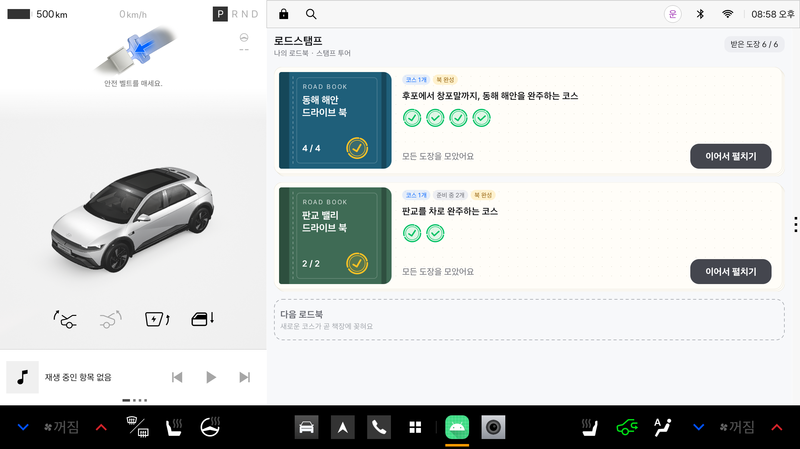
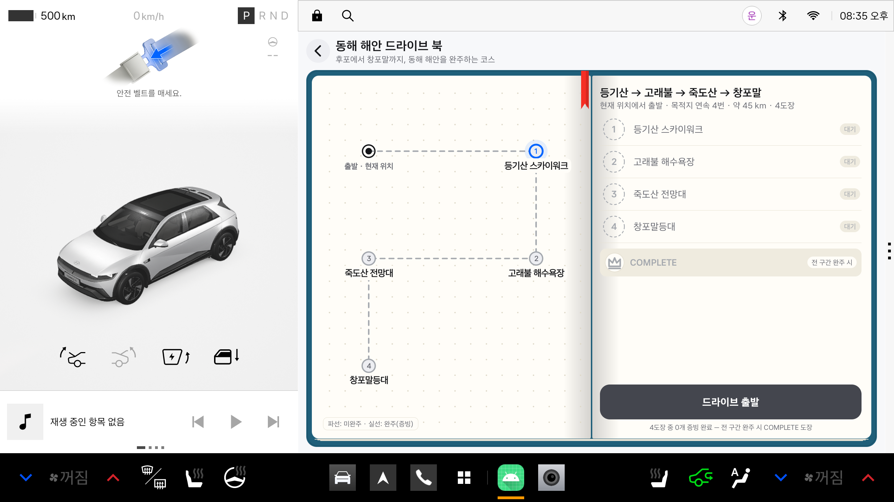
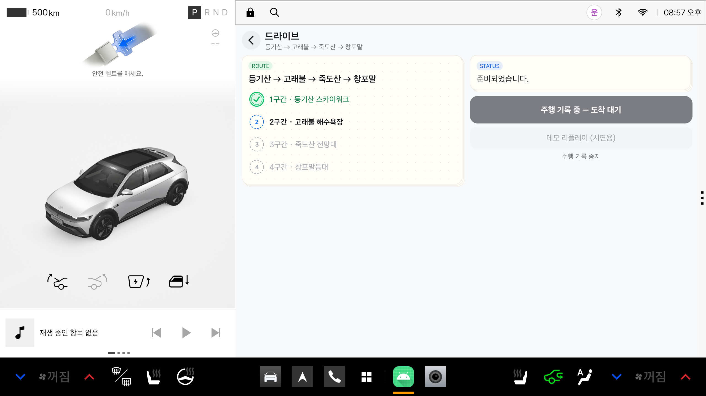
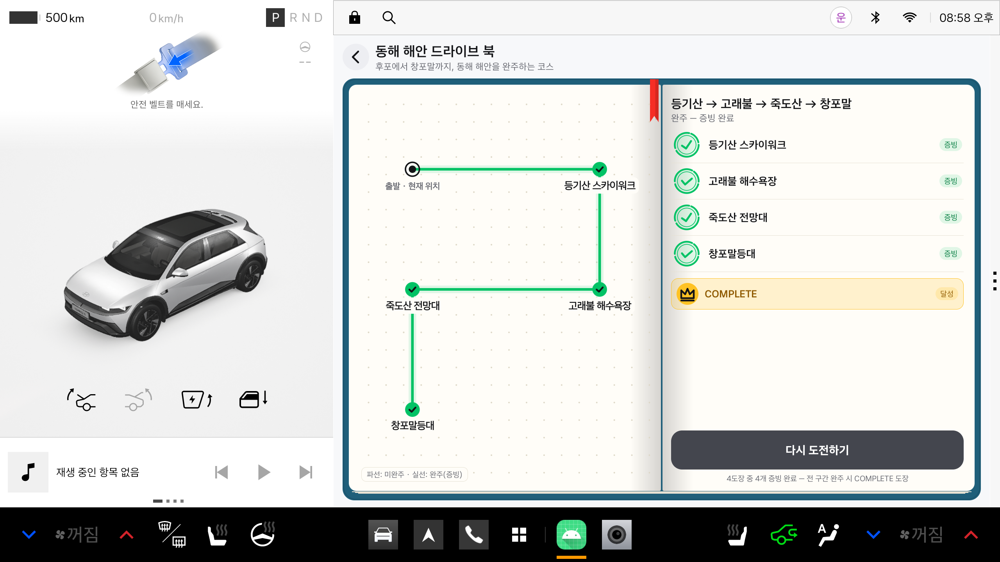
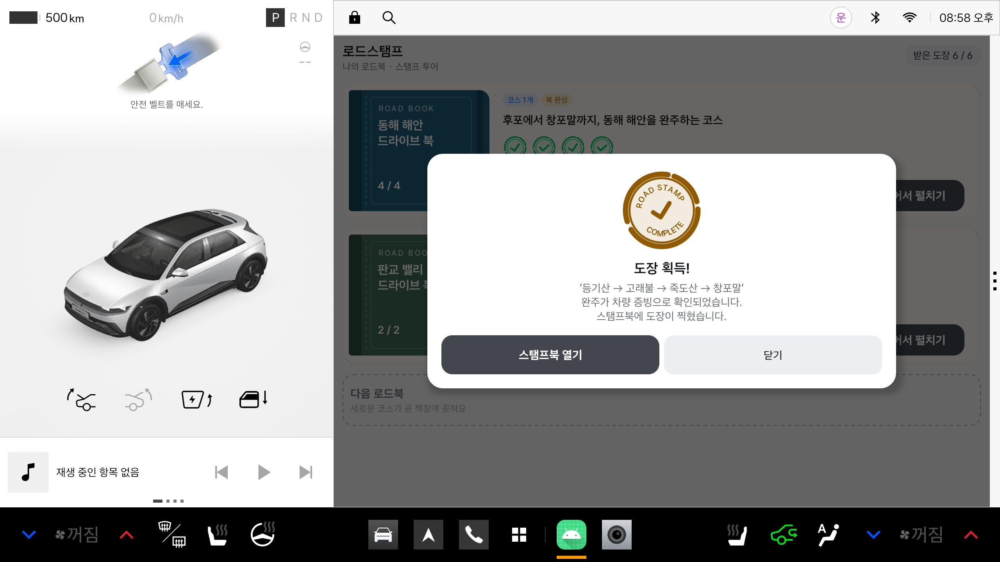

# 로드스탬프 (RoadStamp)

차로 지역 코스를 달리면, 차량이 증명하는 도장이 로드북에 한 장씩 찍히는 Pleos Connect용 스탬프 투어 앱입니다.

국가유산 방문자 여권 투어에서 영감을 받았습니다. 걸어서 스탬프를 찍는 방식으로는 담기 어려운 도로와 차로 둘러보는 자연경관을, 차량이 도착을 판정해 자동으로 도장을 찍어 주는 방식으로 투어에 담습니다.

## 주요 기능

- **로드북 목록**: 앱을 열면 지역별 로드북이 책 표지 카드로 나열됩니다. (동해 해안 북 4구간, 판교 밸리 북 2구간)
- **펼친 책**: 왼쪽에 코스 지도, 오른쪽에 체크포인트별 도장 목록을 보여 줍니다.
- **원탭 출발**: 드라이브 출발 한 번으로 차량 내비에 구간 목적지를 넣고 안내를 시작합니다. 주행 중에는 조작이 필요 없습니다.
- **도착 자동 인증**: FusedLocation 좌표로 도착을 판정하고, 내비 도착 이벤트와 교차 확인해 도장을 찍습니다. 앱 화면이 꺼져 있어도 포그라운드 서비스가 기록합니다.
- **완주 연출**: 전 구간을 마치면 `ROAD STAMP COMPLETE` 팝업이 나타나고, 다시 도전하면 기록을 초기화합니다.
- Pleos 디자인 가이드(색, 서체, 버튼 규격)와 라이트/다크 모드를 따릅니다.

## 화면

Pleos Connect 에뮬레이터에서 캡처한 화면입니다.

로드북 목록: 로드북이 책 표지 카드로 나열되고, 도장 칸과 진행 상태가 보입니다.



펼친 책(시작 전): 왼쪽에 코스 지도, 오른쪽에 체크포인트별 도장 목록이 있습니다.



드라이브 화면: 1구간 도장이 찍힌 뒤 2구간 도착을 기다리는 상태입니다. 이 도장은 FusedLocation 좌표로 판정되었습니다.



완주한 책과 완주 팝업: 아래 두 화면은 앱의 데모 리플레이(시연용)로 구간을 재생해 얻은 화면입니다.





## 사용한 Pleos SDK

| SDK | 용도 | 상태 |
| --- | --- | --- |
| NaviHelper 3.0.5 | 구간 목적지 경로 요청, 경유지·목적지 도착 이벤트 수신 | 구현 |
| FusedLocation 1.1.3 | 실시간 좌표 수신, 반경 50m·순서 검증으로 도착 판정 (미지원·오류 시 내비 이벤트로 폴백) | 구현·검증 |
| Vehicle 2.3.2 | 주행거리·연료 정보를 완주 기록에 활용 | 계획 (의존성만 포함) |

## 구조

```
app/src/main/java/com/ryuseilabs/pleostest/
  HomeActivity.kt        로드북 목록
  BookActivity.kt        펼친 책 (코스 지도 + 도장 목록)
  DriveActivity.kt       드라이브 화면
  DriveService.kt        주행 기록 포그라운드 서비스 (FusedLocation + 내비 이벤트)
  FusedLocationClient.kt FusedLocation SDK 래퍼
  course/                코스 데이터, 도착 판정(ArrivalJudge), 도장 저장
  ui/                    디자인 시스템, 책 장식, 코스 다이어그램
```

도착 판정(`ArrivalJudge`)은 안드로이드 의존성이 없는 순수 Kotlin이라 JVM 단위 테스트로 검증합니다.

## 빌드와 실행

SDK는 Pleos Playground 저장소(`https://nexus-playground.pleos.ai/repository/maven-releases/`)에서 받으며, `settings.gradle.kts`에 선언되어 있습니다.

```bash
./gradlew testDebugUnitTest assembleDebug
adb install -r app/build/outputs/apk/debug/app-debug.apk
```

미리 빌드한 APK는 `apk/roadstamp-debug.apk`에 있습니다. 대상은 Pleos Connect 에뮬레이터(minSdk 34)입니다.

앱에서 코스를 출발하면 `pleos.car.permission.FUSED_LOCATION` 권한을 요청합니다. 에뮬레이터에서 직접 허용하려면 다음 명령을 쓸 수 있습니다.

```bash
adb shell pm grant --user 10 com.ryuseilabs.pleostest pleos.car.permission.FUSED_LOCATION
```

## 에뮬레이터에서 도착 판정 시험

코스 출발 후 위치를 주입하면 FusedLocation이 좌표를 받아 도장이 찍힙니다.

```bash
adb emu geo fix <경도> <위도>
```

체크포인트 좌표는 `app/src/main/java/com/ryuseilabs/pleostest/course/Book.kt`에 있습니다. `scripts/fusedtest.sh <코스ID>`는 코스의 목적지 좌표를 순서대로 주입합니다. 위치를 넣은 뒤 도장이 찍히기까지 에뮬레이터에서 10~35초 걸릴 수 있습니다.

앱 안의 `데모 리플레이`는 위치 주입 없이 앱 내부 좌표 소스(`DemoGps`)로 도착 판정을 재생하는 시연용 기능입니다.

## 현재 상태

- 동해 해안 북 4구간 전체를 에뮬레이터에서 FusedLocation 도착 판정 → 도장 → 완주까지 확인했습니다.
- Vehicle 오도미터 기반 주행 증빙, 코스 음성 가이드(TextToSpeech)는 계획 단계이며 아직 구현하지 않았습니다.
- 세로 화면(좁은 화면) 레이아웃은 코드로 있으나 에뮬레이터에서 확인하지 않았습니다.
